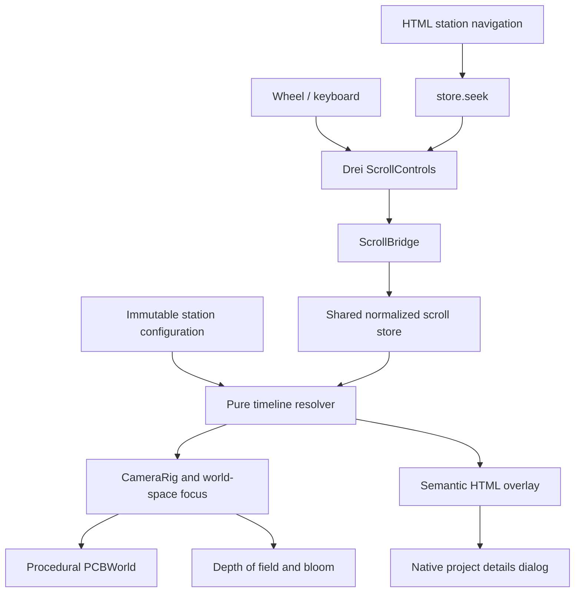

# From Photons to Edge Intelligence

## Design

Alberto Cutone's portfolio is a cinematic, scroll-driven flight over a deterministic procedural printed circuit board. Four stations connect sensing, instrumentation, edge inference, and system architecture. Deep green soldermask, gold traces, restrained cyan accents, macro lighting, and a separate readable HTML narrative establish the visual language.

The full WebGL experience targets laptops. A narrow-screen layout keeps the same scene and adjusts only HTML placement. There are no automatic quality tiers, separate mobile scenes, external model dependencies, or static fallbacks.

## Architecture

The application shell mounts sibling WebGL and HTML layers. Rendering, content, and scroll utilities remain separate:

- `/Users/albertocutone/local/projects/portfolio/src/App.jsx` owns the Canvas, shared store, and modal pause state.
- `/Users/albertocutone/local/projects/portfolio/src/config/stations.js` owns station copy, plain numeric camera and focus tuples, component anchors, and optional destinations.
- `/Users/albertocutone/local/projects/portfolio/src/scroll/timeline.js` resolves camera position, target, focus, active station, transition progress, and card opacity without history-dependent state.
- `/Users/albertocutone/local/projects/portfolio/src/scroll/store.js` exposes snapshot/subscription/seek plus bridge connection and publication. It never exposes a DOM element.
- `/Users/albertocutone/local/projects/portfolio/src/scroll/ScrollBridge.jsx` owns the private Drei container and input routing.
- `/Users/albertocutone/local/projects/portfolio/src/components/3D/PCBWorld.jsx` owns seeded traces, instanced capacitors/vias/pins, chip packages, a sensor die, connectors, and a custom GLSL soldermask material.
- `/Users/albertocutone/local/projects/portfolio/src/components/3D/Scene.jsx` owns macro lighting, camera motion, world-space depth of field, and bloom.
- `/Users/albertocutone/local/projects/portfolio/src/components/2D/Overlay.jsx` owns the narrative, station navigation, and native dialog.

Camera frame updates reuse Three.js vectors. Only the HTML overlay uses `useSyncExternalStore`; the application shell publishes its diagnostic offset attribute through a ref subscription, so scrolling does not re-render the Canvas tree. The depth-of-field target object remains stable. Canvas device pixel ratio is capped at 1.5, antialiasing and effect multisampling are disabled, and repeated geometry uses instancing. The board is generated once using seed 42; scroll changes the camera, not geometry.

## Choreography

| Station | Interval | Subject |
| --- | --- | --- |
| Sensing | 0.00-0.25 | Sensor die at the origin |
| Instrumentation | 0.25-0.50 | Bus near (-1.2, 0, 0) |
| Edge Intelligence | 0.50-0.75 | SoC near (1.2, 0, -1.2) |
| Architecture | 0.75-1.00 | Whole-board overview |

For the first three intervals, the first 70% holds the waypoint and the remaining 30% travels to the next. Position, look-at target, and focus use smoothstep interpolation with no second camera damping layer. Drei is the sole scroll source, with four pages and damping 0.15. The final overview holds through exactly 1.

The outgoing card fades during the first third of travel, then stays hidden. Arrivals fade in over the first 0.02 of an interval; the first station begins fully visible. Hidden cards are inert. Navigation seeks 0.021 into noninitial intervals so the requested station is readable immediately after settling. Reverse scroll evaluates the same pure rules.

The 4.4 x 3.4 board contains all component anchors. Camera waypoints are calibrated to the generated geometry because the source brief did not contain numeric camera positions. Desktop view offset leaves space for the narrative. World-space focus follows the component; overview bokeh is reduced for broad sharpness. HTML never enters the effect compositor.

## Input and Content

The outer overlay ignores pointer events; controls and cards restore interaction. Native wheel input over the Drei container is not forwarded a second time. Wheel input over sibling HTML is forwarded with delta-mode conversion. Ctrl-wheel remains available for browser zoom. Home/End, arrows, PageUp/PageDown, and noncontrol Space seek the flight. Space on buttons retains native activation.

A native modal dialog provides focus containment, an accessible name, Escape handling, a close button, independent internal scrolling, and focus restoration. Opening it freezes the published flight offset and stops underlying input. Closing resumes from the same position.

Copy uses only supplied facts: Meta Reality Labs mixed-reality evaluation, Android/C++, zero-copy IPC and sensor visualization; combined CERN & Matica cryogenic imaging, robotic integration and C++ image-processing drivers; Edge Platforms & PetLog manufacturing firmware, Raspberry Pi pipelines, OpenCV/YOLO/VLM tracking; electronic engineering and perceptual ML integration. No invented dates, metrics, links, or employment claims.

CV/contact actions are optional and absent until real destinations are supplied. CV URLs use Vite's base-aware URL. Project external links are optional.

## Validation and Delivery

`npm test` runs real timeline and store unit tests, covering clamps, interval boundaries, hold/travel interpolation, fades, reverse evaluation, exact offset 1, subscriptions, and command disconnection.

`npm run build` creates production assets with Vite base `/portfolio/`. `npm run test:e2e` uses Playwright Chromium against the production preview at `http://127.0.0.1:4173/portfolio/`. It validates real WebGL, all stations forward/reverse, wheel over scene and cards, keyboard endpoints, navigation, dialog scrolling and focus, absent links, asset/runtime errors, a narrow layout, station screenshots, and an animation-frame sample at 1440 x 900. Tests poll observable settled state instead of fixed sleeps. Failure traces, screenshots, and an HTML report are retained.

The animation-frame sample targets approximately 60 FPS after initialization and records the WebGL renderer. macOS uses installed Chrome for hardware-backed WebGL; Linux CI uses bundled Chromium. `PLAYWRIGHT_CHANNEL` overrides this choice. Bundled macOS headless Chromium uses SwiftShader software rendering on this host, which is not representative of the Apple GPU. Browser, headless mode, and host GPU affect measurements; it is not a universal performance guarantee. Screenshots require visual inspection for framing, focus, legibility, and clipping. Manrope and DM Mono fonts are bundled locally.

The bridge maintains Drei's event target when Canvas initialization reconnects events to its root. Application readiness waits for that event connection and initialization animation frames, avoiding input before the native scroll listener is attached. Browser station helpers also wait for the damped offset to match the native scroll target exactly before testing modal isolation.

The Pages workflow runs `npm ci`, unit tests, production build, and Playwright before upload/deployment. It supports pushes to main and manual dispatch; pull requests validate without deploying. Official Pages artifact and deployment actions use the github-pages environment, scoped Pages/OIDC permissions, and concurrency. Repository Pages settings must select GitHub Actions.

Local acceptance requires unit/build/Playwright success and visual inspection. Full release additionally requires a successful remote workflow run after an authorized push. This session does not publish or change repository settings.
